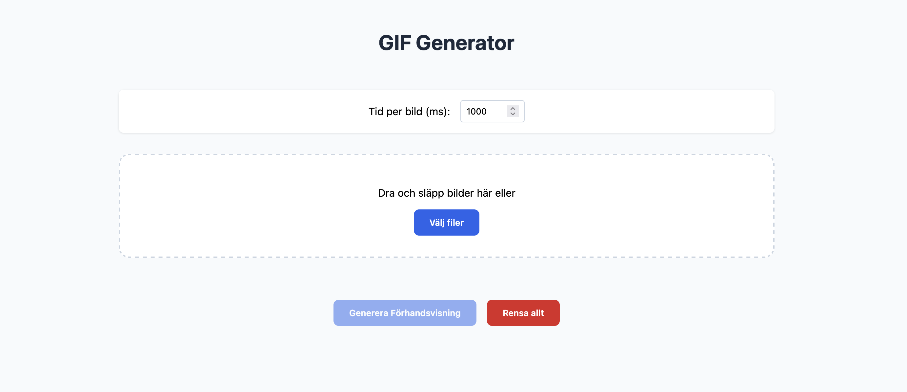
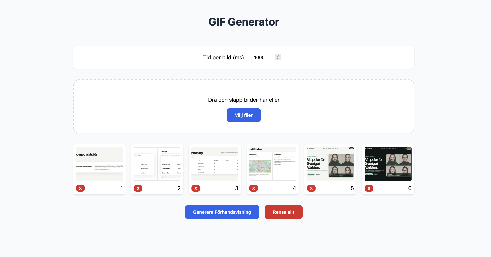
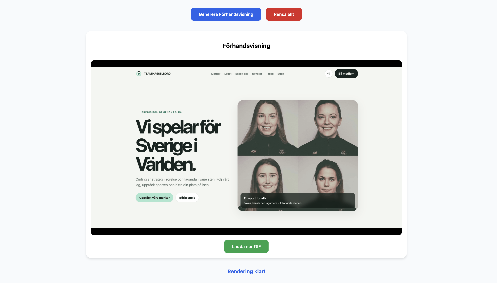

# GIF Generator
Ladda upp bilder. Ange tid i ms. Generera förhandsvisning. Ladda ner GIF.Använder `gif.js` och `worker.js`.
I HTML dokumentet används `` och `https://cdnjs.cloudflare.com/ajax/libs/gif.js/0.2.0/gif.worker.js`

---

---

